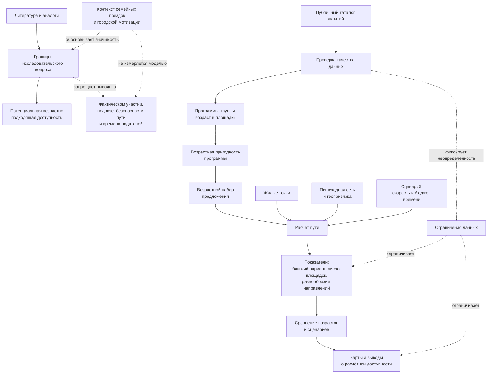

# Как данные формируют оценку доступности

Эта диаграмма показывает теоретическую логику исследования. Сплошные стрелки — входы и преобразования расчётной модели. Пунктирные — контекст, основания и ограничения: они важны для интерпретации, но не становятся измеренным результатом автоматически.

## Как читать схему

1. Литература и контекст нужны, чтобы обосновать вопрос и границы модели, а не чтобы подставить неизвестные данные в расчёт.
2. Центральный объект — не «все занятия рядом», а набор программ, возрастная пригодность которых подтверждена или явно отмечена как неизвестная.
3. Путь рассчитывается при фиксированных исходных точках, сети и сценарии; возраст меняет набор подходящего предложения, а не скрыто меняет условия пути.
4. Результат — сравнимая оценка потенциальной доступности. Она не даёт выводов о выборе семьи или фактическом участии без дополнительных наблюдений.

## Теоретические опоры

| Что в схеме | Зачем нужно | Где проверять основание |
|---|---|---|
| Возрастная пригодность | Отделяет подходящее предложение от всех найденных площадок | [[04-two-level-analysis]], [[evidence-sources-2026-10-26]], [[gap-method-audit-2026-10-26]] |
| Потенциальная, а не фактическая доступность | Не подменяет географическую возможность поведением семьи | [[01-object-subject-goal]], [[escort-context-evidence-2026-11-09]] |
| Сценарии времени пути | Показывают чувствительность, а не детскую норму | [[04-two-level-analysis]], [[06-accessibility-method-comparison]] |
| Неопределённость данных | Не позволяет заменить пропуски точными нулями и сильными выводами | [[03-libraries-and-data]], [[07-program-data-audit]], [[09-system-analysis-uml-2026-10-26]] |
| Проверка результата | Отделяет демонстрацию и план от выполненного территориального эксперимента | [[00-experiment-registry]], [[00-defect-registry]] |

## Что можно редактировать

Mermaid-блок — исходник схемы. Его можно менять прямо в Obsidian: добавить новый вид данных, уточнить показатель или вынести отдельную проверку. Перед изменением стрелок, которые меняют смысл метода, сверяйтесь с [[04-two-level-analysis]] и [[00 Карта решений и доказательств]].
