# Автомобильное сопровождение детей на занятия: что известно

```mermaid
flowchart TB
  classDef evidence fill:#e8f1ff,stroke:#3b82f6,color:#102a43
  classDef finding fill:#ecfdf5,stroke:#059669,color:#064e3b
  classDef caveat fill:#fff7ed,stroke:#ea580c,color:#7c2d12
  classDef action fill:#f5f3ff,stroke:#7c3aed,color:#3b0764

  P[Проблема:<br/>доступ к организованным занятиям<br/>может зависеть от автомобиля<br/>и возможности сопровождения]:::action

  subgraph D[Наблюдения о поездках на занятия]
    direction TB
    L[Lagrell & Kent 2026:<br/>обзор 21 эмпирической работы;<br/>в 7 есть данные о режиме поездок]:::evidence --> LF[Зависимость от автомобиля встречается<br/>в разных контекстах и нередко выше,<br/>чем в школьных поездках]:::finding
    H[Hjorthol & Fyhri 2009:<br/>Норвегия]:::evidence --> HF[В обследованной группе доля автомобиля<br/>на организованный досуг выше школьной;<br/>связана с расстоянием, возрастом,<br/>привычками родителей]:::finding
    B[Berg et al. 2023:<br/>Финляндия, период COVID-19]:::evidence --> BF[Поездки на занятия были наиболее дальними<br/>и обычно зависели от родительского автомобиля]:::finding
    K[Kojima 2022:<br/>Япония]:::evidence --> KF[Самостоятельность зависит от цели поездки;<br/>нельзя считать, что на занятия<br/>ребёнка обязательно везут автомобилем]:::finding
  end

  LF --> P
  HF --> P
  BF --> P
  KF -. предотвращает обобщение .-> P

  subgraph F[Почему решение о сопровождении не сводится к расстоянию]
    direction TB
    S[Silonsaari et al. 2024:<br/>Финляндия]:::evidence --> SF[Практики родительства, мобильность<br/>и самостоятельность ребёнка взаимосвязаны]:::finding
    T[Time, Work, and Family Life 2008:<br/>проверен фрагмент аннотации]:::evidence --> TF[У части работающих матерей<br/>организация досуга ребёнка конфликтует<br/>с оплачиваемой работой]:::finding
    SC[Scheiner 2016:<br/>Германия, школьные поездки]:::evidence --> SCF[Сопровождение связано с возрастом,<br/>доходом, графиком работы, городским контекстом;<br/>сопровождают не только родители]:::finding
    W[Waygood 2011:<br/>старая предварительная выписка]:::evidence --> WF[«Бремя сопровождения» — минуты,<br/>проведённые родителем в пути с ребёнком;<br/>связи со средой слабые]:::finding
  end

  SF --> X[Автомобильное сопровождение —<br/>семейное организационное решение,<br/>а не автоматическое следствие дальности]:::action
  TF --> X
  SCF --> X
  WF -. слабое, требует сверки .-> X

  subgraph A[Что потенциально может уменьшать родительское вождение]
    direction TB
    LN[Lunke & Nordbakke 2024:<br/>опрос 285 родителей, Норвегия]:::evidence --> LNF[Родители считают наиболее перспективным<br/>организованный автобус;<br/>для локальных футбола/гандбола — попутки<br/>и совместные пешие/велопоездки;<br/>для лыж/коньков — хранение инвентаря]:::finding
    BU[Bunds et al. 2018:<br/>одна youth-sport программа]:::evidence --> BUF[Сценарий назначения на ближайший объект<br/>дал модельную оценку: −12% выбросов]:::finding
    ST[Steinmayr et al. 2011:<br/>Германия]:::evidence --> STF[Удалённость спортобъектов связана<br/>с участием в клубах в малых городах и селе;<br/>в крупных городах связь не выявлена]:::finding
    PF[Palm & Farber 2020;<br/>Grow et al. 2008]:::evidence --> PFF[Транспортная доступность, воспринимаемая безопасность<br/>и пешеходная инфраструктура связаны<br/>с участием/активными поездками]:::finding
  end

  LNF --> AA[Нужны разные решения для разных занятий;<br/>клубный автобус не равен городскому ОТ]:::action
  BUF --> AB[«Ближайшая площадка» — только<br/>контрфактический сценарий, не реальный выбор]:::action
  STF --> AC[Близость не имеет одинакового эффекта<br/>во всех типах города]:::action
  PFF --> AD[Безопасность и ОТ — возможные условия,<br/>но не доказанные причины снижения подвоза]:::action

  subgraph G[Границы того, что уже известно]
    direction TB
    G1[Норвегия, Финляндия, Япония, Германия<br/>не являются данными Петербурга]:::caveat
    G2[Доля автомобиля ≠ длительность поездки<br/>и ≠ число часов родителя]:::caveat
    G3[Ни один из собранных источников<br/>не измеряет вклад секций в пробки Петербурга]:::caveat
    G4[Manz 2015: 16% родительских поездок<br/>с целью сопровождения — источник требует проверки;<br/>знаменатель несопоставим с другими цифрами]:::caveat
    G5[Школьные исследования и интервенции пути в школу<br/>не являются прямым доказательством<br/>эффекта для занятий]:::caveat
  end

  P --> Q[Корректная формулировка для ВКР:<br/>в зарубежных исследованиях доступ к занятиям<br/>нередко зависит от автомобиля и сопровождающего;<br/>для Петербурга это мотив исследования,<br/>а не установленный факт]:::action
  X --> Q
  AA --> Q
  AB --> Q
  AC --> Q
  AD --> Q
  G1 --> Q
  G2 --> Q
  G3 --> Q
  G4 --> Q
  G5 --> Q

  Q --> R[Что можно исследовать сейчас:<br/>пространственные условия альтернатив —<br/>возрастно подходящее предложение, разнообразие,<br/>пешеходная сеть, барьеры и при наличии GTFS — ОТ]:::action
  Q -. не позволяет утверждать .-> N[Нельзя без поведенческих данных оценивать:<br/>реальные поездки, долю автомобиля,<br/>время родителей, пробки, выбросы<br/>или эффект на занятость в Петербурге]:::caveat
```

Источники и степень их проверки: [[escort-context-evidence-2026-11-09]], [[какие-решения-уменьшают-подвоз-данные-литературы-2026-11-10]], [[evidence-sources-2026-10-26]], [[waygood-2011]], [[scheiner-2016]], [[manz-2015]].
