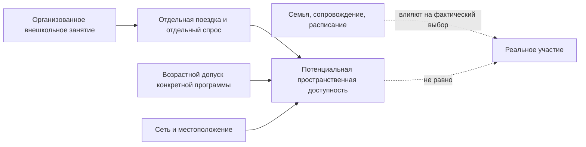
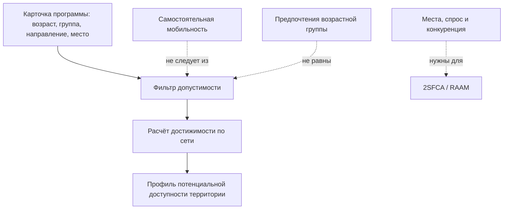

# Детальная карта свидетельств литературы

> **Зачем эта заметка.** Это не «вывод литературы вообще», а маршрут для работы агента и для главы ВКР. Каждая строка фиксирует: конкретный источник → что именно из него можно взять → чего из него выводить нельзя → какое решение он меняет. Поэтому новая методика не должна строиться на общих знаниях модели, когда нужное ограничение уже проверено здесь.

Основная краткая навигация — [[Схема. Как литература формирует теоретическую рамку]]. Реестры с глубиной проверки — [[evidence-sources-2026-10-26]], [[gap-method-audit-2026-10-26]], [[карта-литературы-и-реализуемых-решений-2026-11-10]] и [[escort-context-evidence-2026-11-09]].

## 1. Что именно изучаем

**Рабочее разграничение.** Работа оценивает `C`: какие программы потенциально достижимы при явно заданном сценарии. Она не оценивает вероятность участия `G`, самостоятельность поездки, семейный бюджет, свободные места или предпочтения — пока для этого нет соответствующих наблюдений.

## 2. Организованные занятия: почему это не школа и не свободный досуг

| Источник / заметка | Конкретное свидетельство | Что это даёт ВКР | Чего не даёт |
|---|---|---|---|
| Lagrell & Kent (2026), обзор 21 эмпирической работы — [[карта-литературы-и-реализуемых-решений-2026-11-10]] | Внешкольная организованная активность рассматривается как особая социальная практика семьи, а не как свободное пребывание ребёнка в городе. | Каталог программ нельзя без различения слить со школами, парками или «детскими местами». | Обзор не даёт параметры для Петербурга и не заменяет чтение первичных работ. |
| Leung et al. (2019) — там же | В пятидневных семейных данных занятия разделены на образование, спорт, искусство и хобби. | Проверять, не скрывает ли единый класс «занятия» разные типы предложения. | Не переносить их четыре категории и семейную модель как готовую классификацию каталога. |
| Tal & Handy (2008) — [[evidence-sources-2026-10-26]] | Опрос родителей на детских футбольных матчах сопоставляет фактический способ поездки с расстоянием, возрастом и характеристиками семьи. | Расстояние — не наблюдаемое поведение; его нельзя выдавать за выбор семьи. | Не даёт коэффициент для прогноза поездок петербургских семей. |
| Bunds et al. (2018) — [[evidence-sources-2026-10-26]] | Контрфактическое назначение в ближайшую программу дало оценку 12% снижения выбросов в одном youth-sport кейсе. | «Ближайшее место» допустимо только как явно названный контрфактический сценарий. | Не доказывает, что семьи реально выбирают ближайшую секцию. |

## 3. Доступность: что можно посчитать, а что остаётся за границей

| Источник / заметка | Конкретное свидетельство | Решение для работы |
|---|---|---|
| Geurs & van Wee (2004) — [[evidence-sources-2026-10-26]] | Сравнивает меры доступности по теоретической обоснованности, данным и понятности. | Использовать прозрачную пространственную меру, если индивидуальные наблюдения отсутствуют; не объявлять единственный порог «естественным». |
| Geurs & van Wee (2026) — [[evidence-sources-2026-10-26]] | Различает рассчитанный и воспринимаемый компоненты доступа. | Формулировать результат только как **расчётную пространственную** доступность, не как осведомлённость или реальную возможность посещать. |
| Tomasiello et al. (2023) — [[evidence-sources-2026-10-26]] | Интервальная cumulative-opportunity метрика показывает зависимость результата от выбранного времени. | Показать чувствительность к нескольким порогам/сценариям, а не прятать выбор одного порога. |
| Tavakoli et al. (2024) — [[evidence-sources-2026-10-26]] | Для детей 8–12 лет различаются существование маршрута и его пригодность при учёте дорожной опасности. | Не называть любой сетевой путь «безопасным детским маршрутом». Опасность не включать в формулу без локальных данных и проверенного способа измерения. |
| Fajardo-Magraner et al. (2023), Delafontaine et al. (2012) — материалы аудита литературы | Временные призмы и часы работы уже используются для персональной доступности образовательных объектов. | Расписание — не новая идея; добавлять его можно только при наличии достоверных данных о времени программ и семейных ограничениях. |

## 4. Возраст, программа и ограничение допуска

| Источник / заметка | Конкретное свидетельство | Корректный вывод |
|---|---|---|
| Xiao et al. (2022), препринт — [[evidence-sources-2026-10-26]] | MG2SFCA использует возрастные предпочтения и способы передвижения для детей 0–14 лет. | Возрастная неоднородность существенна. Но предпочтение возрастной группы **не равно** опубликованному допуску конкретной программы; их веса и catchment нельзя переносить. |
| Geng et al. (2026) — [[карта-литературы-и-реализуемых-решений-2026-11-10]] | 500×500 м, дети 0–14, 205 объектов, вместимость/рейтинг, опросные веса и мультимодальная Huff-2SFCA. | Это прямой аналог пространственной оценки внешкольных объектов и контрпример широкого заявления «секции ещё не исследовали». Без мест, спроса и валидированных весов не воспроизводить его 2SFCA. |
| Fattah, Horner & Kim (2026), eRAAM — проверка в сохранённом литературном аудите | Eligibility constraints уже формализуют юридические, институциональные и экономические барьеры; эмпирический кейс — больницы Флориды с местами и конкурирующим спросом. | Возрастной допуск — частный случай ограничения допустимости, а не новое изобретение. Не переносить RAAM-часть без формул, вместимости и спроса. |
| Pennerstorfer et al. (2024), childcare; Milias & Psyllidis (2022) — аудит литературы | Возрастное различение доступа к детским услугам и age-adjusted co-accessibility уже применяются. | Не заявлять первенство соединения возраста и GIS. Вклад может быть только в воспроизводимой адаптации к **программному** каталогу и в сравнении последствий разных уровней агрегации. |
| Saint Paul (2007), Xing (2020), Cheng (2024) — [[gap-method-audit-2026-10-26]] | Возрастные категории, детские места и пространственный доступ уже моделировались в близких областях. | Новизну проверять на точном сочетании данных и вопроса, а не на одном наличии возраста в модели. |

## 5. Семья, сопровождение и цепочки поездок: контекст, но не подстановка данных

| Зафиксированное свидетельство | На что оно влияет | Жёсткая граница вывода |
|---|---|---|
| S01–S02 в [[escort-context-evidence-2026-11-09]]: поездки на занятия в приведённых кейсах чаще автомобильные, чем поездки в школу. | Обосновывает, почему организованные занятия — транспортно значимая тема. | Доля автомобиля не равна времени поездки и не доказывает эффект в Петербурге. |
| S03–S04: общая самостоятельность ребёнка не гарантирует самостоятельности именно на поездке в секцию; в Японии важны цель и возрастной контекст. | Не выводить способ поездки из одного возрастного порога. | Возрастной допуск программы не является моделью самостоятельной мобильности. |
| S05–S06: сопровождение может создавать временное ограничение и конфликтовать с оплачиваемой работой части родителей. | Временные и семейные обстоятельства — причина не трактовать доступность как участие. | Не утверждать универсальную потерю рабочего времени или причинный эффект без локального наблюдения. |
| Takakusagi, Ohmori & Osada (2021) — [[карта-литературы-и-реализуемых-решений-2026-11-10]] | В Utsunomiya моделируются семь сценариев автомобильных цепочек дом–занятие–магазин; приняты 60 минут занятия, 30 минут покупки и одинаковое время обратного пути. | Брать только принцип явного описания сценария. | Не переносить их длительности, цепочки и параметры в Петербург. |
| Commuter-based 2SFCA для daycare (2015) — аудит литературы | Статическая и commute-based доступность заметно различаются. | Домашняя точка не исчерпывает доступность. Но без школы/работы/расписания строить trip-chain модель нельзя. |

## 6. Где результаты не складываются в один вывод

Это не искусственные «противоречия»: чаще источники используют разные данные и отвечают на разные вопросы. Такая таблица не даёт агенту незаметно заменить одно другим.

| Сопоставление | Почему нельзя механически объединить | Решение для статьи |
|---|---|---|
| Geng: 0–14 лет, места, качество, спрос и опросные веса ↔ наш каталог программ с возрастным допуском | У Geng измеряется competition-aware доступ при богатых входных данных; у нас нет валидированных мест, спроса и весов. | Не применять Huff-2SFCA. Сравнить простую сетевую достижимость до/после фильтра программной допустимости. |
| Xiao: предпочтения возрастной группы ↔ Fattah: eligibility constraints | Предпочтение — вероятностная поведенческая характеристика; допуск — правило допустимого множества. | Фильтр допуска не называть оценкой предпочтений и не использовать чужие веса. |
| Tavakoli: маршрут с риском ↔ простая сетевая достижимость | Физически существующий путь может быть непригодным для ребёнка; локального слоя риска и калибровки нет. | Отчётливо назвать метрику сетевой, а не безопасной; безопасность оставить отдельным будущим сценарием. |
| Tal & Handy: реальные поездки семьи ↔ расчётная близость | Наблюдаемое поведение зависит от семьи и организации, не только от расстояния. | Не валидировать модель «фактическим выбором», пока нет собственных данных поездок. |
| Takakusagi: цепочки и расписание ↔ базовая модель из дома | Цепочки требуют точек школы/работы и временных ограничений конкретных семей. | Не добавлять псевдоточную модель сопровождения; обозначить это ограничением. |
| Laxdal et al. (2022) — [[evidence-sources-2026-10-26]] | В аннотации указано 558 участников, в таблице — 588. | Не цитировать точное N до сверки первоисточника; использовать только качественную связь возраста и расстояния как мотивацию. |

## 7. Что считается результатом, а что — нет

| Можно утверждать после расчёта | Нельзя утверждать без новых данных |
|---|---|
| У каких территорий меняется число/доля достижимых возрастно допустимых программ при смене сценария. | Где дети реально занимаются, как они добираются и кто их сопровождает. |
| Насколько при фильтрации по программе меняется ранжирование территорий относительно площадки или укрупнённой категории. | Что фильтрация «ухудшила жизнь» ребёнка: уменьшение множества возможностей математически ожидаемо и само по себе не результат. |
| Насколько вывод устойчив к порогу времени, полноте геокодирования и трактовке неопределённых атрибутов. | Что найденный сценарий оптимален или причинно изменит занятость родителей, трафик либо посещаемость. |

## 8. Минимальный порядок работы агента

1. Открыть эту карту, затем **один** реестр из ссылки у нужной строки.
2. Выписать отдельно: подтверждённое, рабочее предположение, отсутствующие данные.
3. Для методики сверить [[00 Карта решений и доказательств]] и [[00 Каркас ВКР/00. Содержание и логика ВКР]].
4. Если новый источник меняет конкретную строку — добавить его туда с тем, что он подтверждает и чего не подтверждает; не рисовать связь «со всем».

## Покрытие сохранённого корпуса

Карта собрана по актуальным реестрам vault и по более подробному сохранённому аудиту `research/02 Литература`: eligibility constraints, агрегация спроса и предложения, возрастная доступность, допуск и выбор, модификации 2SFCA, сопровождение, расписания, общественный транспорт и открытые мультимодальные методы. Параллельный каталог `research/` не становится рабочей базой: его уникальные выводы в этой заметке перенесены как конкретные ограничения, а первоисточники по-прежнему должны проверяться в реестрах vault.
