# Как литература формирует теоретическую рамку

Это схема не метода расчёта, а логики теоретической главы: какие линии литературы формируют тезисы ВКР и где каждая линия задаёт границу, а не готовый эмпирический вывод.

Ниже — основная схема. [[Схема. Детальная карта свидетельств литературы]] — её текстовая расшифровка: там удобно проверять формулировки и добавлять новые источники, но второй граф там не нужен.

```mermaid
flowchart TB
  classDef source fill:#E8F1FF,stroke:#3B82F6,color:#102A43
  classDef claim fill:#ECFDF5,stroke:#059669,color:#064E3B
  classDef limit fill:#FFF7ED,stroke:#EA580C,color:#7C2D12
  classDef decision fill:#F5F3FF,stroke:#7C3AED,color:#3B0764

  subgraph O[1. Организованные внешкольные занятия]
    direction LR
    O1[Lagrell & Kent 2026:<br/>21 эмпирическая работа;<br/>OOSA — семейная практика]:::source --> OC1[Не смешивать занятия<br/>со школой, парком и свободным досугом]:::claim
    O2[Leung et al. 2019:<br/>образование, спорт,<br/>искусство, хобби]:::source --> OC2[Единый класс «занятия»<br/>может скрывать разный спрос]:::claim
    O3[Tal & Handy 2008:<br/>фактическая поездка связана<br/>с расстоянием, возрастом, семьёй]:::source --> OL1[Расстояние не равно<br/>наблюдаемому выбору семьи]:::limit
    O4[Bunds et al. 2018:<br/>«ближайшая программа» —<br/>контрфактический сценарий]:::source --> OL2[Близость не доказывает<br/>реальный выбор места]:::limit
  end

  subgraph A[2. Что означает «доступность»]
    direction LR
    A1[Geurs & van Wee 2004:<br/>меру выбирают по теории,<br/>данным и понятности]:::source --> AC1[При отсутствии поездок допустима<br/>прозрачная пространственная мера]:::claim
    A2[Geurs & van Wee 2026:<br/>рассчитанный и воспринимаемый<br/>доступ — разные компоненты]:::source --> AL1[Не выдавать расчёт за знание,<br/>зачисление или участие]:::limit
    A3[Tomasiello et al. 2023:<br/>интервальная cumulative opportunity]:::source --> AC2[Проверять несколько<br/>временных порогов]:::claim
    A4[Tavakoli et al. 2024:<br/>путь существует ≠ путь пригоден<br/>для ребёнка при риске]:::source --> AL2[Сеть не называть безопасным<br/>маршрутом без слоя риска]:::limit
  end

  subgraph E[3. Возраст и допуск программы]
    direction LR
    E1[Xiao et al. 2022:<br/>возрастные предпочтения и режимы<br/>для детей 0–14]:::source --> EL1[Предпочтение группы<br/>не равно допуску программы]:::limit
    E2[Geng et al. 2026:<br/>0–14, 205 объектов, места, рейтинг,<br/>опросные веса, Huff-2SFCA]:::source --> EC1[Внешкольные объекты уже<br/>исследуют пространственно]:::claim
    E3[Fattah et al. 2026:<br/>eRAAM учитывает eligibility,<br/>места и конкурирующий спрос]:::source --> EC2[Допуск — не новая идея;<br/>это ограничение множества выбора]:::claim
    E4[Pennerstorfer 2024;<br/>Milias & Psyllidis 2022;<br/>Saint Paul / Xing / Cheng]:::source --> EL2[Возраст + GIS уже есть<br/>в смежных исследованиях]:::limit
  end

  subgraph F[4. Семья, сопровождение, цепочки]
    direction LR
    F1[S01–S02:<br/>в рассмотренных кейсах занятия<br/>автомобильнее школьных поездок]:::source --> FC1[Занятия — транспортно<br/>значимая городская тема]:::claim
    F2[S03–S04:<br/>самостоятельность зависит<br/>от цели поездки и возраста]:::source --> FL1[Возрастной допуск не равен<br/>самостоятельной мобильности]:::limit
    F3[S05–S06:<br/>сопровождение может ограничивать<br/>время и работу части родителей]:::source --> FL2[Не выводить потери времени<br/>без локальных наблюдений]:::limit
    F4[Takakusagi et al. 2021:<br/>7 цепочек дом–занятие–магазин,<br/>заданные длительности]:::source --> FL3[Взять принцип сценария,<br/>но не переносить параметры]:::limit
  end

  OC1 --> Q[Вопрос ВКР:<br/>как меняется потенциальная сетевая доступность<br/>конкретных возрастно допустимых программ<br/>между территориями и сценариями?]:::decision
  OC2 --> Q
  AC1 --> Q
  AC2 --> Q
  EC1 --> Q
  EC2 --> Q
  FC1 --> Q

  OL1 -. граница .-> R[Не измеряем без дополнительных данных:<br/>фактическое участие, способ поездки,<br/>сопровождение, предпочтения, места и спрос]:::limit
  OL2 -. граница .-> R
  AL1 -. граница .-> R
  AL2 -. граница .-> R
  EL1 -. граница .-> R
  EL2 -. ограничивает новизну .-> N[Не заявлять «впервые возраст/GIS/допуск».<br/>Проверяемый вклад: сопоставить уровни агрегации<br/>и показать изменение пространственного профиля.]:::decision
  FL1 -. граница .-> R
  FL2 -. граница .-> R
  FL3 -. граница .-> R

  Q --> M[Методическое решение:<br/>одна сеть и каталог;<br/>сравнить площадку, укрупнённую категорию<br/>и конкретную программу с возрастным допуском]:::decision
  M --> V[Проверить устойчивость:<br/>временные пороги, неполный геокодинг,<br/>неопределённые атрибуты, смена рангов территорий]:::decision
```

## Что означает каждая линия

| Линия литературы | Теоретический тезис для ВКР | Граница, которую нельзя потерять |
|---|---|---|
| Организованные внешкольные занятия и поездки | Внешкольная активность образует отдельный спрос на поездки и не должна без различения сливаться со школой или свободным досугом. | Эти исследования не описывают автоматически петербургскую семью. |
| Семья, сопровождение и time geography | Выбор места и поездки встроены в ограничения семьи, расписание и другие дела. | Без дневников, опросов и расписаний это контекст проблемы, а не измеренный результат. |
| Теория доступности | Расчётная доступность — одна из составляющих более широкого понятия доступности. | Близость или достижимость не равны осведомлённости, восприятию, зачислению и участию. |
| Пространственные аналоги | Пространственные показатели детских мест и внешкольной активности уже существуют. | Нельзя заявлять, что доступность секций или возраст вообще никогда не учитывались. |
| Возраст и мобильность детей | Возраст влияет на возможности и условия, но его роль зависит от задачи и контекста. | Возрастной допуск программы не является доказательством самостоятельной поездки ребёнка. |

## На чём держится схема

- [[Теоретические тезисы/01. Организованные занятия создают самостоятельный спрос на поездки]]
- [[Теоретические тезисы/02. Семейные ограничения не выводятся из расстояния до занятия]]
- [[Теоретические тезисы/03. Возрастной допуск программы не равен самостоятельной мобильности]]
- [[Теоретические тезисы/04. Расчётная доступность — часть более широкого понятия доступности]]
- [[Теоретические тезисы/05. Вклад работы — проверяемая адаптация, а не заявление о первенстве]]

- [[карта-литературы-и-реализуемых-решений-2026-11-10]] — четыре линии корпуса, прямые аналоги и рабочая формулировка вопроса.
- [[evidence-sources-2026-10-26]] — глубина проверки первоисточников, теория доступности и ограничения переноса параметров.
- [[gap-method-audit-2026-10-26]] — аналоги, которые ограничивают претензию на новизну, и формулировка узкого вклада.
- [[escort-context-evidence-2026-11-09]] — основания и пределы утверждений о сопровождении, времени семьи и автомобиле.

## Как превращать в текст ВКР

Сначала раскрывается внешкольная активность как отдельная городская и транспортная проблема, затем показывается многомерность доступности и объясняется, почему в этой работе выделяется её расчётная пространственная часть. После этого разбираются возраст, программная пригодность и существующие аналоги. Завершает главу не заявление о «первенстве», а проверяемый вклад: адаптация оценки к опубликованным возрастным условиям программ и явное представление неопределённости данных.

Mermaid-блок — редактируемый исходник. Если новая статья меняет теоретический тезис, добавляйте её сначала к соответствующей линии и только затем меняйте стрелки и текст вывода.
